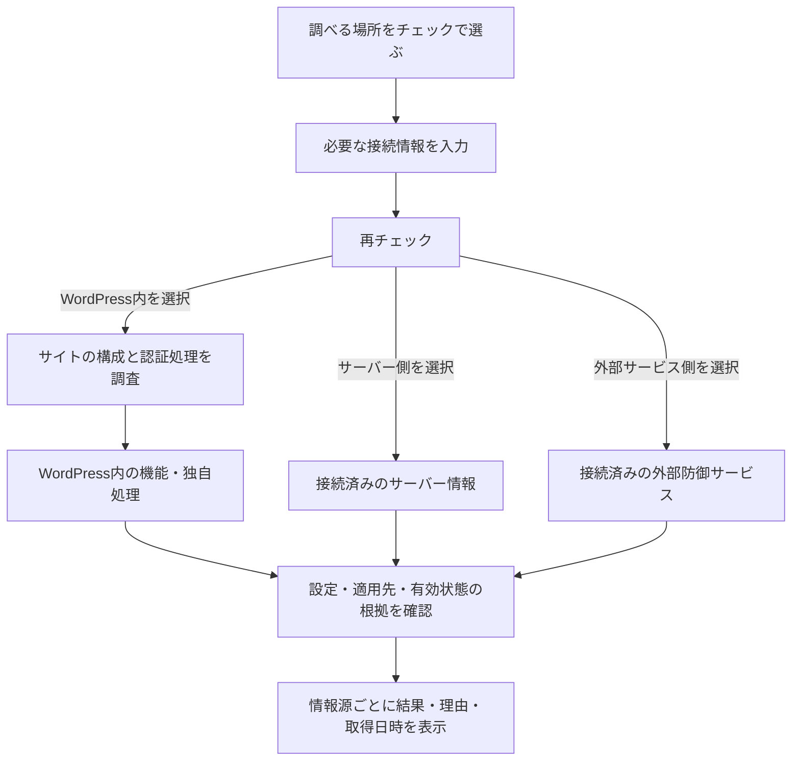

# ログイン試行制限の取得設計・見直し

作成日：2026-11-03。設計時のコード：v0.10.1 / `04413b2`。

本書は取得設計を見直した際の記録です。実装済みの範囲・連携仕様・検証結果は [v0.10.2の改修内容](security-check-0.10.2.md) を参照してください。

## 目的と基本方針

このサイトに既にあるログイン制限の仕組みを調べ、どこで・どのログインに・どんな条件で制限しているかを表示します。新しい制限機能を設置する設計ではありません。

取得を始める相手を製品名で固定せず、サイト内の構成と認証処理を調査してから、見つかった仕組みの設定や記録を確認します。プラグイン内・独自コード内・サーバー側・外部サービス側を別々に扱い、複数の制限を同時に表示します。

通常の再チェックで、接続済みの情報源まで自動確認します。認証失敗を意図的に起こす操作は求めません。外部の非公開設定は、初回の読取り連携が必要です。接続前と制限無効を混同しません。

## 取得前のチェック選択と接続設定（共通部分）

この3か所の選択と接続情報は、①だけでなく1～10で再利用する共通設定として切り出します。[1～10の取得元・共通設定設計](security-check-acquisition-design.md)に、各項目で利用する情報と公開情報照合の扱いをまとめます。以下は①がその共通設定を利用する際の動作です。

「ログイン試行制限」の取得前に、次の3つを独立したチェックボックスで選びます。

| チェック項目 | 初回の選択 | 選択時の設定欄 |
| --- | --- | --- |
| WordPress内を調べる | 選択 | 通常は追加の接続設定なし。プラグイン・テーマ・独自処理を自動調査 |
| サーバー・ホスティング側を調べる | 未選択 | 利用しているサーバーに応じた取得方法と、必要な読取り接続情報。直接参照できる構成では不要な入力を求めない |
| 外部の防御サービスを調べる | 未選択 | 利用しているサービスと必要な接続情報。既存のCloudflare設定が使える場合は再入力を求めない |

画面の構成案：

```text
セキュリティチェック：調べる場所（1～10共通）
  ☑ WordPress内
  ☐ サーバー・ホスティング側
  ☐ 外部の防御サービス

  選択した場所で接続設定が必要なら、この下に入力欄を表示

  ［再チェック］
```

- チェックすると、その場所に必要な設定欄を開きます。設定項目は利用する取得方法に合わせて表示し、使わないサービスの入力欄を並べません。
- 選択と接続情報を入力して「再チェック」を押す操作で、入力の検証・必要な設定の保存・取得開始まで行います。別の保存や接続テストを必須の手順にはしません。
- 既存の接続情報は保存済みと示します。トークン等は再表示せず、空欄で保持・明示的な変更/削除に対応します。チェックを外しただけでは接続情報を削除しません。
- 選択は管理者・サイトごとに保持します。2回目以降は前回の選択を復元し、利用者の選択を接続設定の有無だけで自動変更しません。接続情報の共有範囲と権限は、各取得元の既存設定に合わせます。
- 選択した場所だけで、この項目の調査を行います。未選択の場所は「今回未調査（未選択）」と表示し、過去の結果を今回の確認済み判定に流用しません。
- 選択した場所の接続設定が不足していれば、その行に「接続情報が未設定」等と表示します。ログイン制限そのものの未設定と混同しません。取得可能な他の場所の調査は継続します。
- 3つとも未選択なら、この取得項目は「調査場所未選択」と表示します。制限なし・安全・取得失敗と判定しません。共通設定で独立して選択した公開情報照合は継続できます。
- この項目は、共通設定で選択された場所のうちログイン制限に関係する情報を利用します。取得場所の選択によって、既存の認証記録・失敗の集中の集計方式や防御機能自体を変更しません。
- チェックの変更や設定欄の展開だけでは外部通信を開始しません。取得は「再チェック」で開始します。JavaScript無効時も、同じ選択・検証・表示結果をネイティブフォームで扱います。
- 入力は取得元ごとに検証します。不正な接続情報は保存・使用せず、その取得元の理由を表示します。新しい入力が不正だった際に、古い接続情報で成功したように表示しません。
- 自動続行は開始時の選択を実行情報に固定し、保存済みの接続設定を参照します。続行要求には接続トークンを再送しません。選択や接続設定を変更して再チェックする場合は、新しい条件で実行を開始します。

## 現行コードの問題

| 場所 | 現在の構造と問題 |
| --- | --- |
| `local.php` / `providers.php` | Limit Login Attempts / Reloaded・Wordfenceの実設定とローカル連携を取得する処理が中心。サイト内の認証処理を広く発見する段階がない |
| `identity.limiter` | 制限情報を1件しか持てず、複数の仕組みを取得すると上書きする |
| `assessment.php` | 未導入・無効・読取り未対応・登録未検出を「要設定」にまとめる。何を調べた結果なのか伝わらない |
| `integrations.php` | Cloudflareの通信統計と管理WAF設定を読むが、ログインに適用される回数制限の取得はない。管理WAFの件数からは代用できない |
| 取得データ | 集計期間・適用URL/経路・除外条件・取得元・有効/無効の根拠を保持しない。停止時間を集計期間として使うこともできない |
| 取得する場面 | 管理画面の登録状況だけでは、ログイン時にだけ登録される独自処理を見落とす |

## 取得の流れ



発見と確認は別の処理にします。製品名、関数名、認証処理の登録、ファイル中の文字列だけで「ログイン制限あり」とは判定しません。設定の取得方法が製品ごとに異なる部分は、発見後に使用する読取り処理として分離します。

### 1. WordPress内を自動調査する

- WordPress本体の版、導入済みプラグイン、サイト/ネットワークでの有効状態、MUプラグイン、ドロップイン、有効な親子テーマを一覧化します。停止中のプラグインも停止中と表示し、MUプラグインを通常の有効化フラグで判定しません。[プラグイン一覧API](https://developer.wordpress.org/reference/functions/get_plugins/)、[MU一覧API](https://developer.wordpress.org/reference/functions/get_mu_plugins/)、[ネットワークでの有効状態](https://developer.wordpress.org/reference/functions/is_plugin_active_for_network/)。
- `authenticate`、`wp_authenticate_user`、`login_init`等の認証関連処理に登録された関数・メソッドと提供元を確認します。Reflection等で登録済み処理の所属を調べ、未知の関数の呼出し、停止中プラグインの読込み、任意の認証処理の実行は行いません。[認証フィルター](https://developer.wordpress.org/reference/hooks/authenticate/)、[登録処理の構造](https://developer.wordpress.org/reference/classes/wp_hook/)。
- 管理画面の登録状況と、自然に発生したログイン要求で観測できた登録状況を分けます。ログイン時にだけ存在する処理も記録できるようにします。未観測の経路を「独自処理なし」と扱いません。
- 観測するのは処理の提供元・登録先等の構造です。パスワード、認証引数、利用者名、IP、コード本文、秘密を含むファイルの内容は保存しません。提供元を特定できない動的生成コードも、その状態を表示します。
- 任意のコードの意味を自動で完全判定できるとは扱いません。認証関連処理を見つけても制限の裏付けが取れない場合は「認証関連の独自処理あり・制限の有無は未判定」と表示します。

### 2. 見つかった仕組みの設定を確認する

- 機能の有無、機能自体の有効/無効、認証処理への組込み状態、適用経路、取得日時を別々に記録します。プラグインが有効なだけでは、試行制限の有効設定を確認したことにしません。
- 取得する数値は「何回」「何秒/何分の間に」「何秒/何分停止するか」です。分・秒などの単位を統一し、取得できない値は空のまま理由を表示します。
- 標準ログイン、XML-RPC、REST/アプリケーションパスワード、独自ログイン等の適用範囲を区別します。一つの経路を確認して、他の経路にも適用されると推測しません。独自のログインURLも扱います。
- IPや利用者の除外、条件付き適用、外部サービス側の例外を確認できる範囲で表示します。除外が未取得なら適用範囲にも未確認部分が残ると示します。
- Wordfence等の既存読取り処理は、この確認段階の一部として引き継ぎます。他の製品やローカル実装を追加しても、発見・画面・判定処理を製品ごとに書き換えない構成にします。
- 既存の `wphm_security_auth_facts` から提供される情報は、提供元と根拠を保持します。値だけを返す旧形式は「連携コードからの提供情報」と表示し、適用経路や稼働状態まで自動確認したことにはしません。

### 3. サーバー・ホスティング側を確認する

サーバー側にもリクエストの回数制限があります。例えばNginxの `limit_req` は、設定する場所、継承、試行モードによって実際の扱いが変わります。[Nginx公式仕様](https://nginx.org/en/docs/http/ngx_http_limit_req_module.html)。

- サーバー設定、ホスティングの読取りAPI、管理された読取り連携から、対象サイト・ログインURL・有効設定・制限条件を取得します。
- 設定ファイルを直接扱う連携は、信頼されたローカル設定で指定した既知の範囲に限定します。WordPressの画面から任意のファイルパス、任意URL、シェルコマンドを指定させません。
- ファイルの一部に制限記述があっても、include・継承・対象の仮想ホスト・実際に読込中の設定を確定できなければ「記述あり・適用未確認」とします。
- WordPressから参照できない場合は「サーバー設定は取得不可：読取り連携なし」など、取得経路を表示します。毎回利用者に調査を戻す操作にせず、連携できた後は再チェックで取得します。

### 4. CDN・WAF等の外部サービスを確認する

- API接続済みのサービスについて、対象ドメインが一致することを確認し、ログインURLに適用される制限ルール、ルールの有効状態、条件、取得可能な記録を読みます。サービスの名称やHTTPヘッダーだけで制限ありとは判定しません。
- Cloudflareでは既存の管理WAF件数とは別に、`http_ratelimit` のルールを読みます。取得したルールが対象のホスト・URL・メソッドに適用されるかを確認します。[ルール一覧の取得](https://developers.cloudflare.com/ruleset-engine/rulesets-api/view/)、[回数制限ルールの取得手順](https://developers.cloudflare.com/waf/rate-limiting-rules/create-api/)。
- 複雑な式、例外、skip、アカウント側のルール等を解釈できない場合は「ルールあり・ログインへの適用未確認」とします。式をPHPのevalや未検証の動的正規表現で実行しません。
- 遮断記録を取得できる場合も、ログインに対する制限、対象ルール全体の件数、他の防御による遮断を区別します。従来の認証失敗数と無条件に合算しません。
- 訪問者のIP、URL全文、クエリ、Cookieは要求・保存しません。設定に含まれる秘密や個別IPも、保存前に必要な概要へ変換します。
- 無差別に各サービスへ問い合わせません。初回の読取り接続がない範囲は「外部設定は未取得：接続先/読取り連携なし」と表示します。APIの権限不足、通信失敗、未対応形式を区別します。

## 表示する状態

「ログイン試行制限」という項目名は維持し、その中をWordPress内・サーバー側・外部サービス側に分けます。各仕組みを複数行で表示します。

| 表示 | 必要な根拠 |
| --- | --- |
| 今回未調査（未選択） | その場所は今回の取得で選ばれていない。接続設定の不足や制限無効とは区別する |
| 制限の有効設定を確認 | 対象サイト/認証経路について、有効設定と適用の根拠を取得できた。実際の遮断効果の試験とは区別する |
| 無効を確認 | 特定した機能について、無効設定または停止状態を確認できた。他の仕組みまで無効とはしない |
| 認証関連の独自処理あり・制限の有無は未判定 | 認証への組込みは観測したが、試行制限の設定や動作を裏付けられない |
| 調査した範囲で制限を確認できず | 実際に調べた範囲と結果を表示する。サイト全体の「制限なし」には置き換えない |
| 情報取得不可 | 接続なし、権限なし、読取り未対応等の具体的な理由を表示する |
| 取得失敗 | 通信・応答形式・読取り処理の失敗を表示する。設定無効とは扱わない |
| 調査中・一部未確認 | 経路未観測、処理上限、部分取得等の理由と残っている範囲を表示する |

取得できなかっただけで「要設定」とする現行の処理は置き換えます。接続設定が必要な場合は、具体的にどの取得元の接続が足りないかをその行に表示します。

表示例（設計用の架空のデータ）：

| 場所 | 確認結果 | 仕組み・適用先 | 条件・理由 |
| --- | --- | --- | --- |
| WordPress内 | 制限の有効設定を確認 | 検出した機能A／標準ログイン | 15分以内の認証失敗5回で15分停止。取得元・根拠・日時を併記 |
| WordPress内 | 認証関連の独自処理あり・制限の有無は未判定 | 有効なテーマの独自処理 | 認証への組込みを観測。制限条件を読める根拠は未取得 |
| サーバー側 | 情報取得不可 | サーバーの防御設定 | 読取り連携なし。制限の有無は未判定 |
| 外部サービス側 | 制限の有効設定を確認 | 外部サービスのルールB／ログインへのPOST | 1分30リクエストまで。認証失敗数による制限とは区別 |

## 根拠とデータの持ち方

`identity.limiter` 1件から、独立した `facts.login_limits.sources[]` へ移します。新しい報告形式にはスキーマ番号を付けます。

| 情報 | 保持する内容 |
| --- | --- |
| 取得元 | 安定した識別子、場所、名称、製品/実装の版、取得手段 |
| 存在と状態 | 導入/検出状態、機能の有効/無効/不明、適用範囲の確認状態 |
| 制限の種類 | 認証失敗回数、リクエスト数、失敗を契機にするIP制限、その他、不明 |
| 適用先 | 対象サイト・認証経路・URLのパス・HTTPメソッド・除外等の概要 |
| 数値 | 回数上限、集計期間、停止時間。未取得はnullとし、0や初期値で埋めない |
| 根拠 | 設定取得、登録処理の観測、提供元の記録、連携コードの申告等を区別した説明 |
| 取得状態 | 正常、未選択、未接続、権限不足、未対応、失敗、期限切れ、上限到達、未観測 |
| 日時 | 設定取得・観測の日時、有効期限、最後に正常取得した情報の日時 |

「機能が存在」「有効な設定」「認証への適用」「実際の制限記録」を別の根拠として持ちます。ルールの存在と遮断効果を同じ意味にしません。手動申告は自動取得した根拠とは別に表示します。

一つ確認できても、別の取得元での失敗・未確認を消しません。古い正常情報を残す場合は期限切れと現在の取得失敗を明示し、最新の有効設定として扱いません。

## 判定・負荷・他機能との関係

- この取得結果は既存機能の有無と設定の確認です。制限を有効化/変更したり、認証結果を変更したりしません。
- ブルートフォースのリスク判定では、確認できた設定と対象経路を根拠にします。機能名・登録関数・一般のHTTPエラーだけで低としません。認証失敗の集中を見つけた注意判定は、設定確認によって弱めません。
- WordPress以外の遮断は、WordPressへ到達した認証記録からは復元しません。「認証記録」「失敗の集中」の集計方式は今回の取得設計と分離します。
- 主な調査は管理者の再チェックで行います。ログイン時の観測は、既存の認証を妨げない小さな構造記録に限定します。通常の閲覧で全ファイル調査や外部照会を開始しません。
- 実装時の初期上限は、構成情報500件、登録処理の調査500件/処理、ログイン経路の観測100件/回・同一構造の保存は10分に1回まで。処理時間・件数・保存容量を実測して調整し、打ち切りを「存在しない」と表示しません。
- ローカル観測は1サイト合計256KiB以内、外部設定キャッシュは1取得元128KiB・全体1MiB以内を初期上限とします。生の設定全文やログ全文は保存しません。
- 権限・有効状態・POST・nonce、期限付き排他、固定HTTPS送信先、証明書検証、応答サイズ・タイムアウトの上限を維持します。新しい任意URL入力や任意ファイル指定の入口は追加しません。
- 外部照会は既存の時間予算内で取得元ごとに枠を設けます。既知脆弱性照合の自動続行と同じキューに載せる場合は処理種別を分け、一方の失敗で他方を無限にやり直しません。
- 実行中にプラグイン・テーマ・ネットワークでの有効状態・調査場所の選択・接続設定が変われば古い取得処理を終了します。通常の認証件数や観測日時の変化では続行を無効化しません。

## 実装の分離と移行

`tools/security_check/login_limits/` に、構成/登録処理の発見、取得元ごとの読取り、共通形式への検証・変換、表示状態の判定を分けます。既存のMFA確認は `providers.php` に残し、ログイン制限の変更と混ぜません。

`facts.php` は調査結果を集め、`assessment.php` と `evidence.php` は共通形式から表示します。製品名の条件分岐を画面へ追加し続ける構造にはしません。旧形式の1件だけでは新設計の全体調査が完了したと見なさず、画面キャッシュのスキーマを更新します。

## 実装後の受入条件

| ケース | 必須の結果 |
| --- | --- |
| 初回表示・再訪 | 初回はWordPress内だけ選択し、再訪では管理者・サイトごとの前回選択を復元する。外部通信は開始しない |
| 1か所だけ選択・複数選択 | 選択した場所だけ取得し、未選択の取得元への外部通信や古い結果の流用をしない |
| 全項目未選択 | この取得項目を未選択と表示する。共通設定で独立して選択した公開情報照合は妨げない |
| 選択先に必要な接続情報がない | どの取得元の設定が不足しているかを表示し、取得可能な他の場所は調べる |
| 接続情報が保存済み | トークン等の再入力を強制せず、画面・応答・続行要求に秘密を再表示/再送しない |
| チェック解除・選択変更 | 接続情報は明示削除まで保持し、今回未調査と設定不足を区別する。新しい実行条件へ切り替える |
| JavaScript無効・入力形式不正 | サーバー側でも選択と接続情報を検証し、不正な設定を保存/使用しない |
| 対応済み2製品が未導入 | 他の実装・外部情報の調査を継続し、一括で「要設定」にしない |
| 通常プラグインが停止中 | 導入状態と停止状態を表示し、他の制限まで無効と判定しない |
| 通常プラグイン以外の独自実装 | MU・ドロップイン・テーマ等の認証処理と提供元を観測し、裏付けのない制限あり判定をしない |
| ネットワークでのみ有効 | 有効状態・対象サイト・ネットワークのログイン経路を取り違えない |
| ログイン時だけ処理を登録 | 管理画面で未検出だった結果と自然なログイン時の観測を区別して表示する |
| 未知の関数・動的生成コード | 調査のために呼び出さず、提供元や制限の有無が不明な範囲を表示する |
| プラグイン側と外部側に制限あり | 両方を表示し、数値・期間・対象を上書き/無条件合算しない |
| サーバー側だけで制限 | 連携できれば設定と対象を表示し、連携できなければ取得できない理由を表示する |
| Cloudflareの一般WAFだけが有効 | それだけをログイン試行制限ありの根拠にしない |
| 外部ルールが無効・別ホスト・別URL・試行モード・例外付き | 対象ログインで有効な制限として一括認定しない |
| API未接続・403・通信失敗・未対応の式 | 原因を区別し、制限なしと扱わない |
| HTTP 403/429、Basic認証、CAPTCHA、2FAのみ | 回数制限の裏付けがなければログイン試行制限ありと認定しない |
| 上限・期限切れ・形式不正・途中変更 | 未確認範囲を残し、古い情報で確認済み/低としない |
| 複数管理者・複数サイト | 結果・接続情報・排他・キャッシュの参照範囲を分離する |
| 攻撃・意図的な認証失敗を行わない | 設定取得と自然発生イベントの観測だけで調査を進める |
| 他の機能 | 認証設定・防御機能・既存ログ・更新通知・他ツールの動作を変更しない。取得共通化が他の9項目へ与える影響は個別に検証する |
